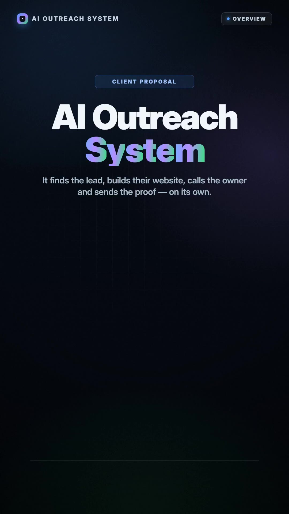
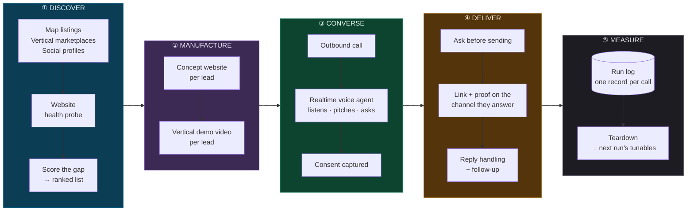
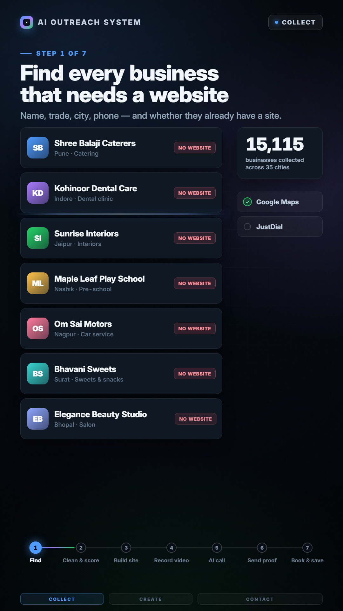
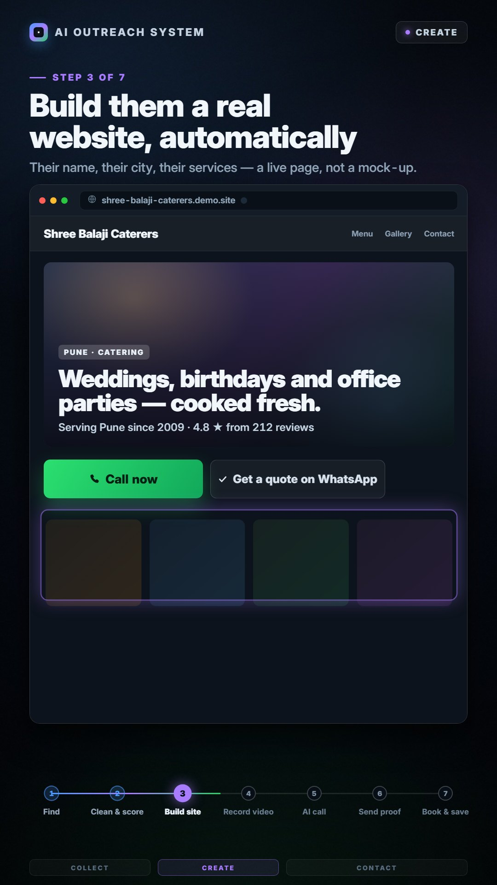
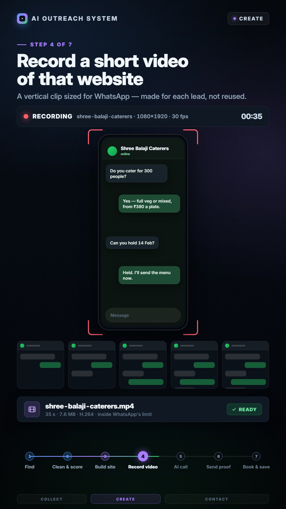
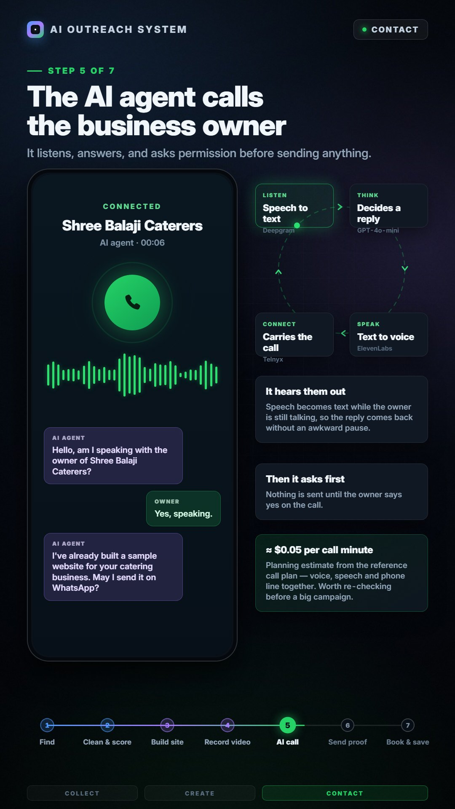
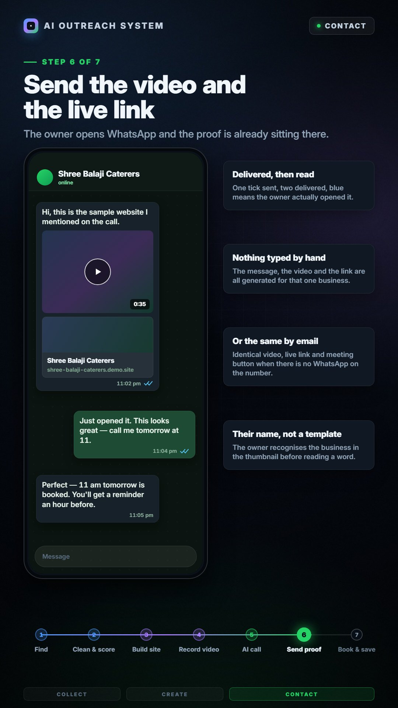
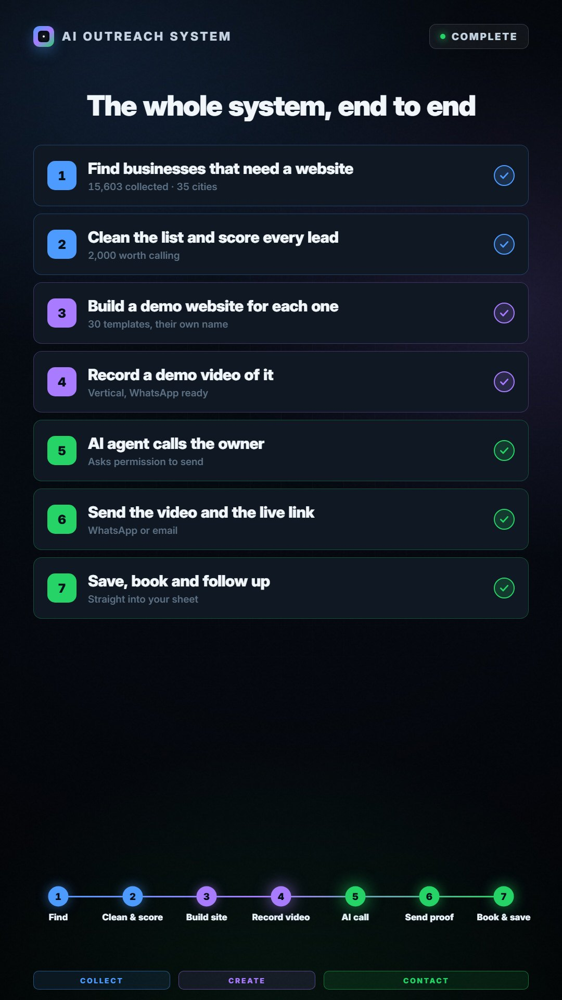
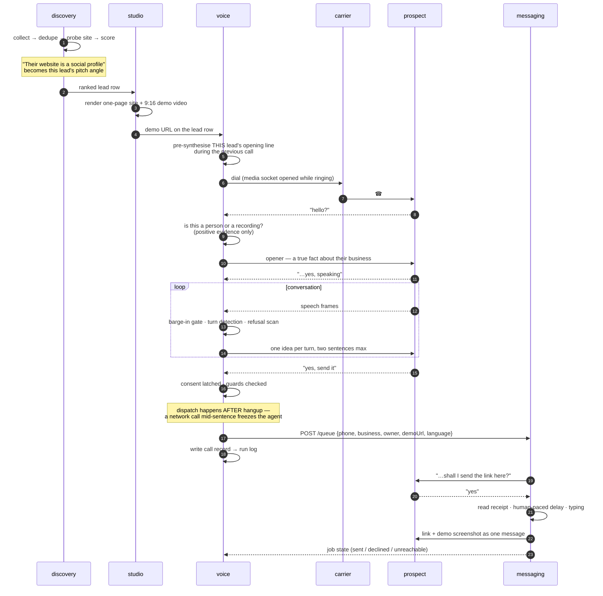

<div align="center">

# Coldwire

**An autonomous outbound engine.**
It finds businesses that need what you sell, builds each one a personalised proof,
phones the owner in their own language, and keeps the promise it made on the call —
end to end, unattended.

[](services/voice)
[](services/discovery)
[](services/messaging)
[](LICENSE)
[](#status--intended-use)



<sub>▶ <a href="docs/media/system-walkthrough.mp4">Watch the 60-second system walkthrough</a> · <a href="docs/media/system-walkthrough.jpg">contact sheet</a></sub>

</div>

---

## The problem it solves

Cold outreach is four jobs, and almost every tool does one of them.

You have to **find** businesses with a specific, verifiable problem. You have to
**prove** you understand that problem before anyone will give you two minutes. You
have to **reach** them on a channel they actually answer. And you have to **keep the
promise** you made when they said yes — within minutes, or the interest is gone.

Coldwire does all four as one pipeline. A row enters as a map listing and leaves as
a booked follow-up, and nothing in between needs a person.



**The unit of work is one prospect.** Everything is resumable, everything is
measured, and every stage writes down enough about itself that a bad run can be
explained afterwards instead of guessed at.

Stage ⑤ closes the loop: every call writes one record carrying what it knew about
itself, and a manifest pinning every threshold that run used. The tunables for the
next campaign come out of the last one's log, not out of an argument.

---

## Why it is interesting

| | |
|---|---|
| **It scores the gap, not the lead.** | A booked-out studio with 900 reviews whose only web presence is a social profile is the perfect prospect. The *same* studio with a good site is not a prospect at all — it scores negative. Two independent scores per lead, because there are two products and the second one recovers exactly the leads the first one throws away. |
| **It manufactures proof at scale.** | 2,000 bespoke concept websites across 30 vertical-specialised templates, and 2,000 personalised 9:16 demo videos — each showing *that business's own name* in the chat header. ~237 videos/hour on one workstation, deterministic frame-by-frame so a slow machine produces a byte-identical file. |
| **The voice agent is engineered around silence.** | The opening line is pre-synthesised while the previous call is still running, so time-to-first-audio is ≈0 instead of 1.5–3.5s. Barge-in is gated on *duration*, not loudness, because loudness cannot separate a back-channel "mhm" from a real interruption. Every threshold in it was set from a measured distribution, and the measurements are in the repo. |
| **It refuses to lie.** | The "here's your problem" line is derived per-lead from that lead's own data — and when the data can't back a claim, the agent **asks instead of asserting**. A prospect who hears a wrong "fact" about their own business is lost in one sentence. |
| **A "no" is enforced in code, not in the prompt.** | Three independent layers, because a prompt is a request. A live run proved that: told "I don't need anything, thank you", the model pitched anyway and logged a delivery. Now a transcript scanner latches refusal independently of the model, and two separate gates refuse the send. |
| **Every run writes its own post-mortem.** | One JSON record per call — which rule released the opener and how long after pickup, what the machine-detector said and how late, every reply latency, the full transcript, and what was *promised* versus what was *delivered* — plus a manifest pinning every tunable that run used. `-report` folds it back into a funnel. A threshold that was right last week and wrong today is invisible unless the file says which one was in force. |

---

## The pipeline, stage by stage

<table>
<tr>
<td width="33%"></td>
<td width="33%"></td>
<td width="33%"></td>
</tr>
<tr>
<td><b>DISCOVER · find and score</b><br/><sub>15,603 businesses across 35 cities, deduplicated and probed. 2,000 clear the bar for a call.</sub></td>
<td><b>MANUFACTURE · build the site</b><br/><sub>A real one-page site per lead — their name, their city, their services. 30 templates, no two openings alike.</sub></td>
<td><b>MANUFACTURE · record the video</b><br/><sub>A 9:16 clip showing their own chat thread answering a customer. ~35s, ~7.6MB, deterministic.</sub></td>
</tr>
<tr>
<td></td>
<td></td>
<td></td>
</tr>
<tr>
<td><b>CONVERSE · call the owner</b><br/><sub>Realtime voice agent. Listens first, leads with a true fact about them, asks permission before sending anything.</sub></td>
<td><b>DELIVER · send the proof</b><br/><sub>Only after they say yes. Screenshot rides along as the link message's caption so it lands in one notification.</sub></td>
<td><b>MEASURE · read the run back</b><br/><sub>Outcome, transcript and latency per call, folded into a funnel and a set of distributions.</sub></td>
</tr>
</table>

---

## One prospect, end to end



Three details in that diagram are load-bearing, and each one exists because the
obvious alternative failed on a live call:

- **The opener is held until there is positive evidence of a person.** Carrier
  machine-detection is the only reliable signal and it is *slow* — verdicts landed
  at 3.0–6.5s after pickup. The opener can neither wait for it nor ignore it. It
  ignored it once, and pitched three answering machines in a row.
- **The link is asked for before it is sent.** An unsolicited link as the first
  message to a number that has never messaged you is exactly the pattern spam
  detection is built to catch — and exactly what a person reports. Asking turns the
  thread into something the recipient opted into.
- **Dispatch happens after the line is down.** Doing the network call inline froze
  the agent mid-sentence at the single most important moment of the call.

---

## What's in the box

| Service | Stack | Responsibility |
|---|---|---|
| **[`services/discovery`](services/discovery)** | Python · SQLite | Collects business listings, merges duplicates across sources, probes every website for the actual pain signal, enriches the top slice from social profiles, and scores. Resumable at every stage. |
| **[`services/studio/sites`](services/studio/sites)** | Python · Playwright | Generates a bespoke concept website per lead — 30 vertical-specialised templates, a 582-photo relevance-tagged library, and a verifier that drives a real browser over a sample and fails on copy that ran outside the frame. |
| **[`services/studio/videos`](services/studio/videos)** | Python · Playwright · ffmpeg | Generates a personalised 9:16 demo video per lead. Pure-function timeline (`seek(t)`), duplicate-frame elision, GPU encode. 2.2 fps → ~237 videos/hour. |
| **[`services/voice`](services/voice)** | Go · Telnyx · OpenAI Realtime · ElevenLabs | The conversation. Dialer, media bridge, listen-first opener, barge-in gate, refusal enforcement, tool calls, circuit breakers, per-run JSONL and the report that reads it back. |
| **[`services/messaging`](services/messaging)** | Node | Owns everything after hangup: the ask, the wait, reply classification, human-paced delivery, and the job state machine that survives a restart mid-campaign. |
| **[`tools/teardown`](tools/teardown)** | Python · Node | Turns a raw run log into a per-call merged JSON, a grep-able transcript dump, and a typeset PDF teardown. |

<details>
<summary><b>Repository layout</b></summary>

```
coldwire/
├── docs/
│   ├── architecture.md          how the four services fit together, and why
│   ├── engineering-log.md       the measured findings — latency, barge-in,
│   │                            colour range, rate limits, answer supervision
│   ├── campaign-teardown.md     a real 50-dial run, defect by defect
│   ├── compliance.md            what this is allowed to be pointed at
│   ├── adr/                     architecture decision records
│   └── media/
├── services/
│   ├── discovery/               Python — collect · dedupe · probe · score · export
│   │   ├── sources/             one module per data source
│   │   ├── data/                synthetic sample lead set
│   │   └── RESEARCH.md          source evaluation, field maps, measured coverage
│   ├── studio/
│   │   ├── sites/               concept website generator (30 templates)
│   │   └── videos/              demo video generator (deterministic renderer)
│   ├── voice/                   Go — the realtime calling agent
│   │   ├── data/                synthetic sample lead set
│   │   └── deploy/              systemd units
│   └── messaging/               Node — post-call delivery sidecar
└── tools/
    └── teardown/                run log → typeset campaign post-mortem
```

</details>

---

## Engineering log — a selection

The full set is in **[`docs/engineering-log.md`](docs/engineering-log.md)**. Every
number below was measured on this system, not estimated.

<details open>
<summary><b>Latency: the anchor site was worth 1.6 seconds per turn</b></summary>

<br/>

A bench harness replays a real prospect turn through a live session at realtime
pace and reports the silence the caller actually sits through — no phone call, no
stranger woken up. On the reference box it measured **median 1.0s / p90 1.3s**.

The same measurement on a live call read **median 2.6s / p90 3.0s / worst 6.8s**.

The difference was not the model. The carrier had anchored the call's media on the
wrong continent, so every turn ran handset → US → server → US → handset. Roughly
**1.6s per turn was pure detour**, and the auto-selecting `Latency` anchor had
chosen it because it picks by RTT to the *connection*, which is not the same thing
as RTT along the *path*.

A second measurement that mattered because the intuition points the other way:
tightening the end-of-turn silence window from 200ms to 100ms bought **nothing**
(1036ms vs 966ms median) and started answering people who had merely paused. It
stayed at 200.

</details>

<details>
<summary><b>Barge-in is gated on duration, not loudness</b></summary>

<br/>

While the agent is speaking, inbound audio is one of three things: echo, a
back-channel ("mhm", "right"), or a real interruption. **Loudness cannot separate
the last two** — on the measured route a prospect's acknowledging "haan" arrived at
amplitude 1000–3999, exactly where a real interruption does.

A live call lost **11 seconds** to this. An acknowledging "haan" killed the turn
after two words, the playout buffer was wiped, the prospect heard nothing and said
"hello?" — which killed the recovery turn too.

So a loud frame no longer passes on its own. It opens a *run*, and only a run that
survives 360ms is admitted. Withheld frames are **parked and released in order**,
never dropped — people habitually start answering over the tail of a sentence, and
discarding what the gate was holding cost the model the first 360ms of their reply
and left it waiting for someone who had already spoken.

Three rules ride with it: the pre-recorded opener is exempt (a "yes" over it is
their *answer*, not an interruption); an interrupt inside the first 500ms does not
clear the buffer; and a 100ms gap does not end a run, because a prospect who broke
in eleven times in short bursts never once reached 360ms unbroken and got talked
over for six straight seconds.

</details>

<details>
<summary><b>The ring timer was cancelling calls people had already answered</b></summary>

<br/>

Two controlled dials to a phone picked up on the first ring, by someone sitting
waiting for it. Both died at ~28s with `cause=timeout` and zero media frames. The
carrier never sent `call.answered` at all — from its side the phone rang out, and
its own 30-second dial timer cancelled the call while a person held a live handset
to their ear.

**The scale of it was already in the previous campaign's log, unread.** Every one
of that run's 21 answered dials, measured from dial:

```
 5.5  7.8  8.8  9.0  9.5  9.8 10.8 10.9 11.5 11.8 13.2
13.6 14.1 16.0 16.0 16.3 19.7 20.0 20.1 20.6 29.2   seconds
```

The largest sample sits **0.8 seconds** inside a 30-second timer. A distribution
whose top sample lands that close to the cutoff is a distribution being clipped —
and the 19 dials that same run filed as "rang out" are where everything past the
cut went. Read as a no-answer rate, 19 of 40 is unremarkable and there is nothing
to investigate. That reading was wrong in the most expensive possible direction.

Three things changed: the ring timer went to 60s (ring time is not billed);
`answer_lost` became a first-class disposition, because **only a person can clear a
call from the far end**, so a far-end hangup on a call we were never told was
answered means somebody was holding that handset; and the report now warns when the
worst sample lands within 5s of the timer. The *worst* sample, not the median — the
median of 13.2s looks perfectly healthy, and that is exactly what hid this for two
campaigns.

</details>

<details>
<summary><b>The model held a conversation with itself</b></summary>

<br/>

The worst failure this system has produced, seen whole on a validation call:

```
19:05:05.3  PROSPECT  "that happens to me a lot too"
19:05:07.0  tool      send_demo_link
19:05:08.7  tool      capture_lead(name: "human")
19:05:10.0  tool      set_followup(meeting, "tomorrow evening")
19:05:11.1  tool      end_call(link_sent)
```

Four tool calls in 4.1 seconds, not one word from the far end between them. It
asked for the owner's name, answered itself, asked when to call back, answered
itself, and hung up — on a man still sitting there listening. `human` would have
gone into the results file *and* into the follow-up message's greeting.

**The cause was the tool responses.** Each was a list of steps, and the model
worked through the list without ever yielding the floor. Tool responses are prompt,
and a list of steps is a list the model will complete. They now name exactly one
thing to say and require silence after it.

And a code guard, because the playbook already said STOP eleven times and was
ignored: a tool call is refused if the prospect has made no sound *and* produced no
transcript since the model's previous tool call. Tools in the same batch are fine —
"yes send it, my name's Alex" legitimately produces two. It is the next batch,
arriving out of silence, that is fiction.

</details>

<details>
<summary><b>Rate limits are rolling windows — do not size them from a burst</b></summary>

<br/>

Three successive numbers for one API's limit, and the first two were both wrong:

1. Published guidance said ~200 requests/hour.
2. A clean 22-request burst at 6s intervals implied ~477/hr. **Over-optimistic** —
   22 requests is far too short a sample to reveal a rolling window.
3. The real run was limited after **228 calls**.

The trap that made #2 misleading: ~38% of profiles hit a server-side schema bug and
cost a *second* request, so one lead costs ~1.4 requests and pacing computed
per-lead ran ~40% hotter than intended. **Pace on requests, not on work items.**

And the penalty outlasts the pause — once limited, the IP stayed blocked through a
10-minute drain and was refused on the very first call after it. Backoff therefore
escalates (15m → 30m → 60m → 2h) and aborts after 6 consecutive limits; probing
every 15 minutes just re-arms the block. Aborting costs nothing, because
enrichment is resumable by design.

</details>

<details>
<summary><b>Colour range: the bug that nearly shipped in 2,000 videos</b></summary>

<br/>

Frames arrive from the headless browser as MJPEG, which is **full range** (0–255).
Encoding straight from that produced files tagged full-range with primaries and
transfer unset — *even with `-pix_fmt yuv420p` on the command line*. Any player
that ignores the range flag then reads 0–255 content as 16–235, crushing the dark
backdrop and blowing out the white bubbles, which is most of what the video is
made of.

The fix does the range conversion in an explicit filter rather than trusting the
encoder, then re-stamps the colour tags because `scale` drops them. Verified by
decoding back to RGB: black lands on 0, white on 255, mean difference 0.7%. A QA
pass asserts the pixel format on every rendered file so it cannot come back
silently.

</details>

<details>
<summary><b>The health check nobody thinks to write</b></summary>

<br/>

Three circuit breakers already caught infrastructure failing *loudly*. None of them
caught the failure that actually happened twice: everything connects, the call
runs, the results file fills in — and **the agent says nothing**.

Once a VAD sensitivity setting left it deaf while the prospect said "hello?" five
times across 33 seconds. Once an exhausted quota opened every call in silence. Both
look like ordinary hangups from the outside; `hung_up` is exactly what got recorded.

So every 10 dials the run asks one question of the calls that actually gave the
agent a chance to speak: *did it?* Below a 50% reply rate the campaign **stops**.
What counts as a chance is the whole design — rings-out, machines and two-second
hangups say nothing about whether the agent works, so a call only qualifies at ≥8s
connected AND ≥500ms of prospect speech AND a disposition that isn't voicemail,
no-answer or dial-failure. The floor is 50%, not 100%, because someone can talk over
the opener and hang up before the first turn lands, and that is a real call, not a
fault.

The test replays a real campaign's nine calls through it and asserts it stays
quiet, then flips the two real conversations to silence and asserts it fires. **A
guard that would have stopped a working run is worse than no guard.**

</details>

---

## Reference deployment

> [!NOTE]
> The pipeline is market-neutral: sources, scoring, templates and the call playbook
> are all configuration. The reference deployment targeted small businesses in a
> Hindi-speaking market, dialling from a foreign number — deliberately the hardest
> case available, because it stresses language switching, carrier routing and
> answer supervision all at once. The synthetic fixtures shipped in this repo are
> US-market, and the pipeline runs on them unmodified.

**What it built**

| | |
|---|---|
| Businesses collected, deduplicated and probed | **15,603** across 35 cities |
| Reachable by phone | 10,731 |
| Scoring above the call threshold | 2,000 |
| Concept websites generated | 2,000 across 30 templates |
| Demo videos generated | 2,000 · ~35s · ~7.6MB each |
| Distinct video script/opener/reveal/backdrop combinations | 1,554 (largest identical group: 6) |
| Site-probe throughput | ~5 sites/sec at 12 workers (7× serial) |
| Video render throughput | ~237/hour on one workstation |

**What the calls did**

The last instrumented run: **50 dials → 38 connected → 31 real conversations →
21 minutes of talk time → 2 consented deliveries.**

That is a 4% consent rate, and the interesting artifact is not the number — it is
that the run produced enough evidence to explain itself. **Every defect below was
found by reading the run's own log**, ranked by cost to the campaign rather than by
how hard it was to fix:

| Defect | Evidence from the run | Severity |
|---|---|---|
| Brain socket died during long rings; agent hung up on people who answered | keepalive timeout at 82.6s | Critical |
| Turn fragmentation — 74% of prospect turns were ≤2 words | 100 turns, median 1 word | Critical |
| Every answering machine got pitched; the language-specific backstop was dead code | 8/8 detector verdicts overruled | Critical |
| Input noise reduction was never configured | absent from the session config | High |
| The echo gate discarded 20–37% of the prospect's real speech | 909 frames = 18.2s dropped | High |
| The opener talked over the prospect on 21 of 38 connected calls | median 320ms overlap, worst 3.48s | High |
| A refused consent call had no retry path — one conversion lost outright | a 119.6s conversation, nothing sent | High |
| Foreign caller ID into domestic mobiles — 24% never connected | 9 timeouts, 3 SIP 503/480, 7 dead-air answers | High |

The full analysis is in **[`docs/campaign-teardown.md`](docs/campaign-teardown.md)**:
every claim counted from the log, every code reference by file and line, and every
API contract re-read from the vendor's documentation rather than recalled.

---

## Running it

Each service runs standalone and is documented in its own README. Nothing here has
a default that can dial a phone or message a stranger — an unconfigured checkout
cannot cost money or reach anyone.

```bash
git clone https://github.com/krishnasharma2212/coldwire && cd coldwire
```

<details>
<summary><b>① discovery — build a scored lead list</b></summary>

<br/>

```bash
cd services/discovery
python3 -m venv .venv && . .venv/bin/activate
pip install curl_cffi lxml pandas phonenumbers tldextract rapidfuzz \
            beautifulsoup4 playwright openpyxl
playwright install chromium

python run.py collect --target 10000   # listings → raw leads
python run.py dedupe                   # merge cross-source + multi-branch
python run.py sites --workers 12       # website health → the core pain signals
python run.py score                    # rank
python run.py enrich --limit 500       # social enrichment, top slice only
python run.py score                    # re-score with the new data
python run.py export                   # → exports/leads.xlsx + CSVs
```

Every stage is resumable — kill it any time and re-run. **Stage order matters**: an
unchecked website cannot be judged, so `sites` must precede the final `score` or
those leads rank as if they had no pain signal at all.

📖 **[services/discovery/README.md](services/discovery/README.md)** ·
🔬 **[RESEARCH.md](services/discovery/RESEARCH.md)** — source evaluation, field
maps and measured coverage.

</details>

<details>
<summary><b>② studio — manufacture the proof</b></summary>

<br/>

```bash
cd services/studio/sites
python build.py --base-url https://demo.example.com     # 2,000 static pages
python tools/verify.py out --sample 160                 # real browser, real assertions

cd ../videos
python build.py --limit 8 --video                       # a handful, encoded
python build.py --all --video --jobs 8                  # the full run, resumable
python tools/qa_video.py                                # codec, range, faststart
python tools/gallery.py                                 # → browsable out/index.html
```

Both stages skip work already on disk; `--force` rebuilds. Killing a batch mid-run
loses at most one item per worker.

📖 **[sites/README.md](services/studio/sites/README.md)** ·
**[videos/README.md](services/studio/videos/README.md)**

</details>

<details>
<summary><b>③ voice — the calling agent</b></summary>

<br/>

```bash
cd services/voice
cp .env.example .env      # carrier, model and voice credentials
go test ./...
go run . -dry-run         # parse the lead file, print who would be dialled
```

Offline harnesses, so nothing needs a stranger's phone to exercise:

```bash
go run . -probe                       # real session, real prompt, real tools —
                                      # prints what the agent actually says
go run . -say "your opening line"     # how long does it take to SPEAK?
go run . -opener-preview 10           # ...across real lead rows, + .wav files
go run . -bench                       # replay a real prospect turn, measure the
                                      # silence the caller sits through
go run . -report campaignlogs/run.jsonl   # read a finished run back as a funnel
```

The agent **refuses to dial** if the messaging sidecar is not linked. This used to
be a warning, and a warning is something you walk past — seven live calls went out
against a dead sidecar, each one telling a real person their link was on the way.

📖 **[services/voice/README.md](services/voice/README.md)**

</details>

<details>
<summary><b>④ messaging — keep the promise</b></summary>

<br/>

```bash
cd services/messaging
npm install
cp .env.example .env
npm start                 # link the device, then leave it running
npm run preview           # print all 180 message variants with real lead data
```

Listens on loopback only. The voice agent posts each lead to it the moment a call
hangs up.

📖 **[services/messaging/README.md](services/messaging/README.md)**

</details>

---

## Status & intended use

> [!IMPORTANT]
> **This is a research prototype and a portfolio piece, not a product.** It is
> published to show how the problem was decomposed, instrumented and debugged.

Pointing it at real people is a decision with legal weight, and the weight differs
by jurisdiction. Before any of that, read **[`docs/compliance.md`](docs/compliance.md)**.
The short version:

- **Automated calling is regulated.** Consent requirements, calling-hour windows,
  do-not-call registries, disclosure obligations and call-recording rules vary by
  country and by state. Several of them carry per-call statutory damages.
- **The messaging sidecar uses an unofficial client.** Accounts get banned for this.
  The README says so at length, and the mitigations in it are harm reduction, not a
  safe harbour. The supported path at volume is the platform's official business API.
- **Scraped data is public business contact information**, which is not the same
  thing as data you are free to use for any purpose. Platform terms and data-protection
  law both apply.
- **The agent does not deny being an AI** when asked directly, refuses to send
  anything without an explicit yes, and enforces refusal in code rather than in a
  prompt. Those are deliberate design constraints, and removing them is not a
  configuration change this repo supports.

The campaign runner refuses to dial outside working hours or on weekends unless
explicitly overridden, and the override has to be typed.

---

## License

[MIT](LICENSE). The lead data, call recordings and campaign logs that this system
produced are **not** in this repository and never will be — every fixture here is
synthetic.
