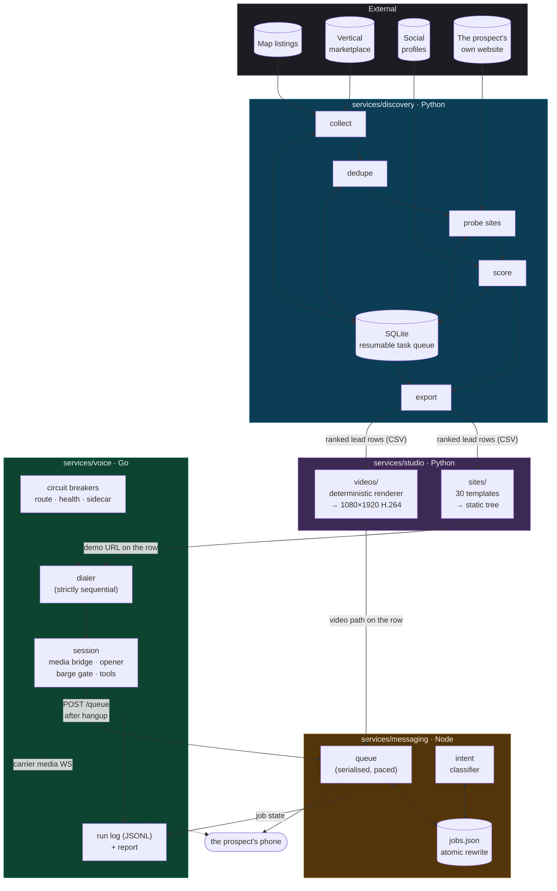
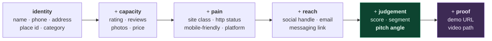
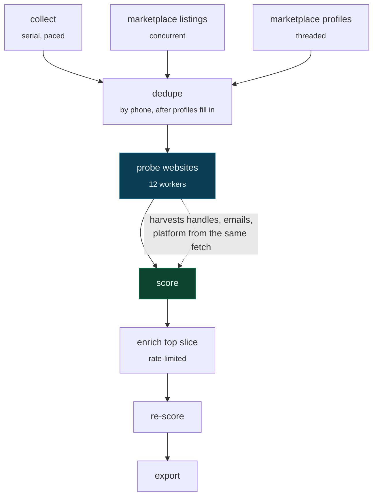
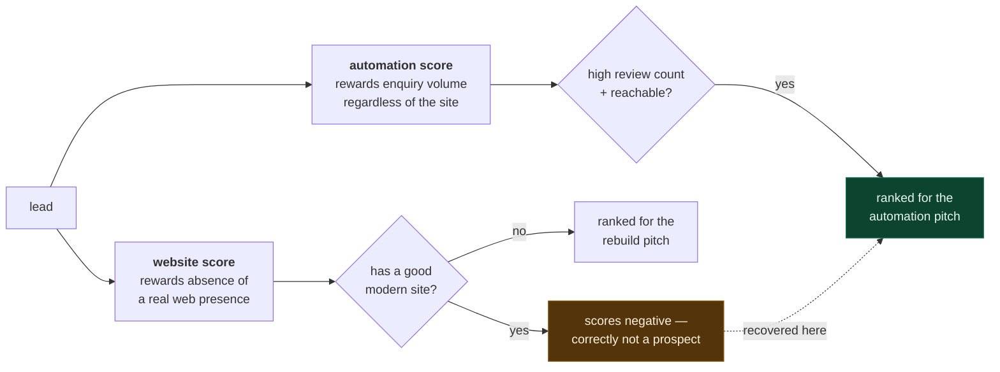
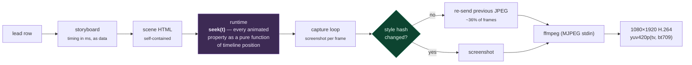
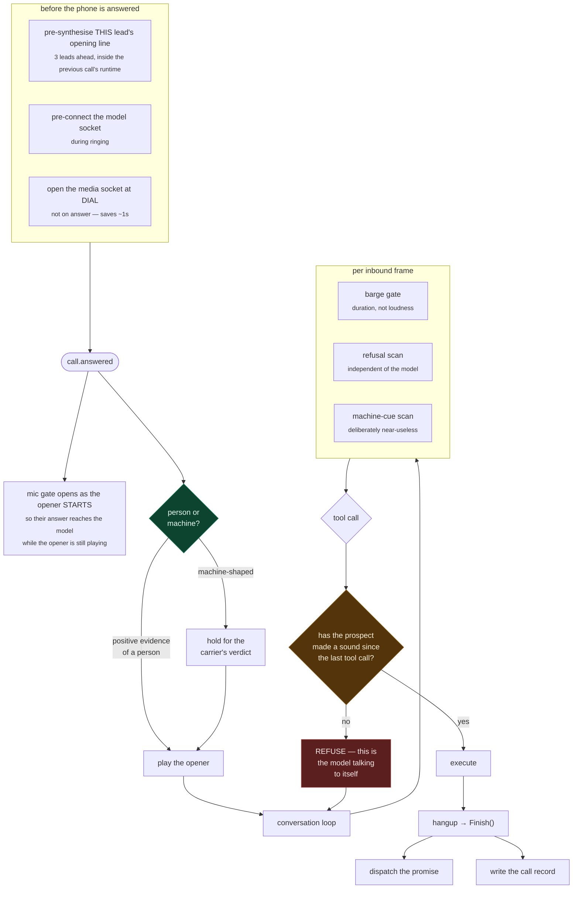
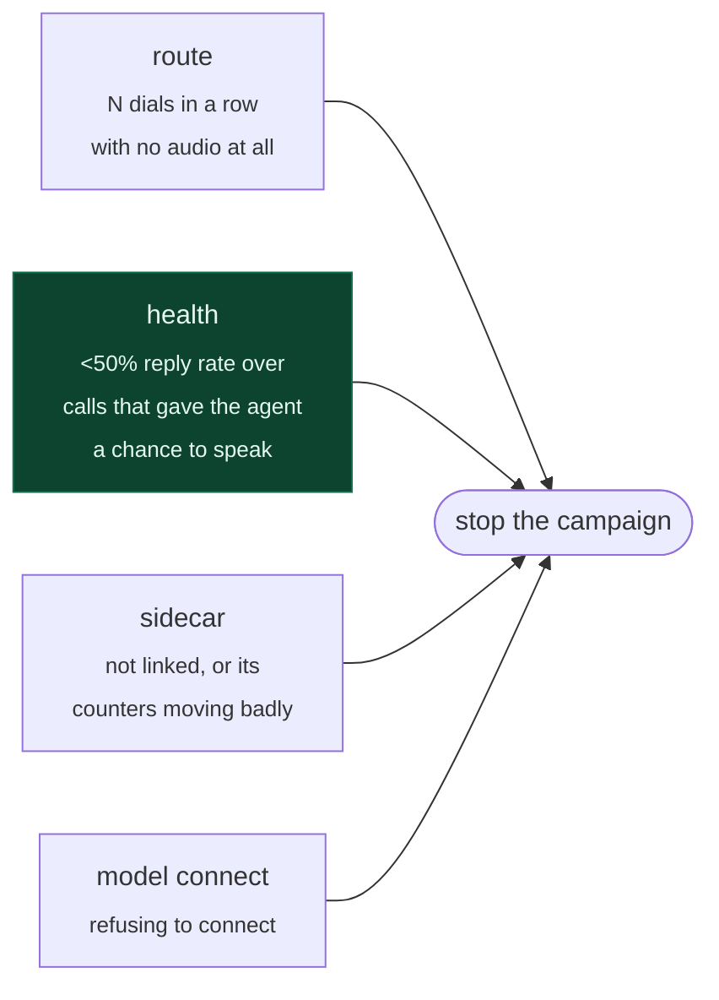
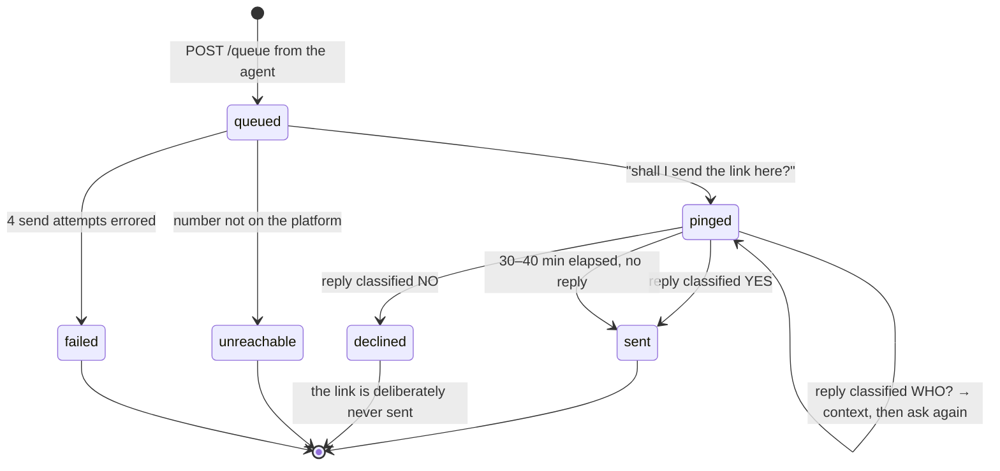
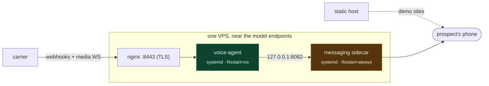

# Architecture

How the four services fit together, what crosses each boundary, and why the
boundaries are where they are.

---

## 1. The shape of the system

Coldwire is four processes, three languages, and one contract: **the lead row**.

### Why these four, and not one

The split is not aesthetic. Each boundary is where the **failure modes stop being
alike**.

| Boundary | What changes across it |
|---|---|
| discovery → studio | Network-bound and rate-limited becomes CPU/GPU-bound and embarrassingly parallel. One is paced by someone else's anti-bot policy; the other is paced by how many cores you own. |
| studio → voice | Batch becomes realtime. A 200ms stall is invisible in a video render and is *the product* on a phone call. |
| voice → messaging | Synchronous becomes durable. The call is over in 60 seconds; the promise it made has to survive a process restart, a 40-minute wait and a reply that arrives tomorrow. |

The languages follow from that. Python where the work is scraping, parsing and
rendering and the libraries are there. Go where a single process holds two
WebSockets, a codec, a timer wheel and a state machine under a hard latency budget.
Node where the only usable client for the messaging platform lives.

---

## 2. The lead row is the contract

Every stage reads and writes the same widening record. Nothing else crosses a
service boundary.

**`pitch angle` is the load-bearing field.** It is not a label — it is the exact
sentence the agent is allowed to say about this business's web presence, derived
from that business's own probe result. Everything downstream treats it as the
authority, and the raw website cell as advisory, because a blank cell must not
override an explicit classification.

Columns are mapped **by header name**, case-, space- and underscore-insensitive, so
a hand-edited CSV or a different export column order still works. Numbers arrive as
floats from the exporter (`474.0`) and are trimmed before anything speaks them out
loud — nobody says "four hundred seventy four point zero" on a phone call.

---

## 3. discovery — collect, merge, probe, score

### Stage graph

Three properties make the concurrency safe, and all three were learned the hard
way:

1. **The database must not live on a network-backed filesystem.** WAL mode needs
   shared-memory sidecar files that a 9p/v9fs mount does not properly support, and
   the symptom is intermittent `database is locked` crashes the moment two stages
   overlap. Measured after moving it to a local filesystem: **8,798 concurrent
   writes/sec, zero lock errors**, against a hard crash before.
2. **Writes commit per row, not per batch.** Batching 50 updates behind one commit
   holds the write transaction open for the whole batch — at network speed that is
   *minutes*, and every other stage dies. Commits are cheap; batching bought
   nothing and cost the run.
3. **Writes go through a retry wrapper.** A busy timeout is not sufficient on its
   own: in WAL mode a connection that reads and then writes after another has
   committed gets an *immediate* snapshot conflict that the timeout does not wait
   out. The wrapper backs off and retries, and re-raises non-lock errors untouched.

### The dedupe pass has to be separate

At insert time, duplicates are caught on place id first, then on
`(phone, name-prefix)`. Merges never clobber: a later source can only fill blanks.

But a marketplace listing has **no phone number** until its profile is fetched, so
its duplicate of a map listing is simply *invisible* at insert time. The later
`dedupe` pass groups by phone once the numbers exist, keeps the row with the most
populated fields, and folds the others into it. It also catches multi-branch
businesses on one owner's number — merging those is intentional, because they are
one sales conversation, not two.

### Two scores, because there are two products

The website score deliberately destroys leads that already have a good site.
Correctly — they are not rebuild prospects. But those are frequently the *best*
automation prospects: digitally mature, high enquiry volume, fielding messages by
hand. Measured across the collected data, the share of businesses that already have
a real website ran from **33% (bakeries) to 81% (interior designers)** — so scoring
on the rebuild pitch alone buried an entire vertical to position 111 of the top
2,000. The second score recovers it.

**Four false-positive traps the model deliberately avoids**, each of which produced
a wrong "fact" the agent would have said out loud:

| Trap | Why it matters |
|---|---|
| A throttled fetch is not a dead site | 429/403/503 mean *we* were blocked, not that the site is broken. Scoring them as dead invents a large pain signal and pushes leads to the top for a reason that isn't true. They score as **unverified** and get re-probed. |
| A directory profile is not a website | A vendor whose "website" is a marketplace profile is renting a page on someone else's platform — that is its own pitch, not "you have no site". |
| A missing website *field* is not a missing website | Marketplace listings never carry one, so a blank there scores as **unknown**, not absence — otherwise every marketplace lead rockets to the top on a signal never measured. |
| A toll-free number means a chain | Real small businesses use mobile numbers. Toll-free prefixes caught franchise operations that the name blocklist missed. |

The `unknown` bucket is why the agent has an **ask** branch: never assert a gap the
data cannot back up.

---

## 4. studio — manufacturing proof

Two generators, one shared discipline: **the render must be a pure function of the
data**, so it can be verified, parallelised and resumed.

### sites

2,000 static pages, 30 vertical-specialised templates, no build step on the host.
The dataset contains no photography at all, so pages draw on a relevance-tagged
stock library — every photo tagged by vertical *and* topic, galleries filled
topic-first round-robin so no gallery shows six near-identical shots and no two
businesses in the same city open on the same photograph.

The verifier drives a real browser over a sample and fails on the things a
screenshot cannot show: copy that ran outside the frame (the stage's
`overflow:hidden` crops it silently), a title that wrapped to two lines, an
unsubstituted template slot, any network request, any console error.

### videos

**The page never animates itself.** Nothing uses CSS animation, transition,
`requestAnimationFrame` or `Date`. Two consequences, and both are the point:

- The same input always produces the same file.
- A slow machine produces the *same file* as a fast one, rather than dropping
  frames — which is what any real-time recorder would do.

That purity is also what makes the biggest optimisation legal: `seek(t)` returns a
hash of every style it wrote, an equal hash means identical pixels, and the encoded
JPEG is re-sent instead of screenshotted. **~36% of frames are never captured.**
This is why the camera holds dead still through the conversation — a slow push-in
would be imperceptible at ~2px/sec and would change a transform on every frame,
defeating the whole optimisation.

Getting from 2.2 fps to ~237 videos/hour was six changes, and the largest was not
the encoder:

| Change | Effect |
|---|---|
| Large-radius CSS blur → multi-stop radial gradients | **308ms → ~0 per frame.** The blur was re-rasterised every time ambient drift moved it: 74% of the entire frame cost, for two soft light pools a gradient renders identically. |
| Static background baked to a JPEG | ~44ms/frame → one blit |
| `backdrop-filter` removed | ~17ms/frame; nothing behind those elements was worth blurring |
| Frame-rate limit disabled | Headless otherwise pins every screenshot at exactly 50ms |
| Duplicate-frame elision | ~36% of frames never captured |
| Encoder thread pool capped | Left to default, six workers exhausted 8GB and drove the machine into swap |

---

## 5. voice — the realtime agent

One Go binary. Calls are **strictly sequential**: the next dial waits for the
previous to finish, because the scarce resource is the operator's attention when
something goes wrong, not the phone line.

### Inside a call

### The listen-first opener

The single hardest decision in the call is made in the first two seconds: **is this
a person or a recording?** On the first two seconds of audio, the two are the same
signal. Measured frame-by-frame off one run's own prospect channels:

| Call | | Shape |
|---|---|---|
| #4 | human | spoke 1,320ms straight, then quiet for 6.6s |
| #6 | machine | spoke 280ms, **paused 940ms**, carried on |
| #7 | machine | spoke 60ms, **paused 1,020ms**, carried on |
| #3 | machine | continuous, longest internal gap 80ms |
| #5 | human | silent for 3.1s, then spoke |

A validation call then produced the hardest sub-case: a person answered with a
**280ms sound and waited 8.4 seconds** — the same 280ms, in the same position, as
machine #6. *Nothing about the sound itself separates them.* What separates them is
the silence **after**: 8,440ms against 940ms and 1,020ms.

So the decision fires on **positive evidence of a person and nothing else**, and the
errors are deliberately asymmetric: speaking too early to a machine costs a couple
of seconds of carrier time and the detector hangs up anyway; waiting too long on a
person loses the lead. The tell that does the work is that **a person who answers
says one thing and waits for the caller; a recorded greeting pauses for breath and
starts again.** A second utterance before the agent has spoken at all is the only
cheap machine signal that survived measurement.

The decision is a pure function precisely so those six calls can be replayed against
it in a test instead of argued about.

### Guards, and where they live

| Guard | Lives in | Why not in the prompt |
|---|---|---|
| Refusal ends the call | transcript scanner + two dispatch gates | The prompt said "send it anyway, it's free". The model obeyed. A prompt is a request. |
| No self-conversation | code check on prospect audio + transcript since the last tool call | The playbook already said STOP eleven times and was ignored. |
| A number the opener already spoke is withheld from the model | the research builder omits it entirely | The prompt told it not to repeat the number. It used what it was handed. **What the model cannot see, it cannot repeat.** |
| Cannot claim a gap the data can't support | per-lead pitch angle with an explicit `ask` branch | A wrong "fact" about someone's own business is caught in one sentence and the call is dead. |

### Circuit breakers

Four, and each catches a different *shape* of failure:

A voicemail deliberately does **not** count toward the route breaker: a machine
answering proves the route completes calls.

### The run log

`results.csv` answers *what the outcome was*. It does not answer the question that
actually comes up afterwards, which is *why*. Reconstructing the first live run meant
reading a 53KB text log, correlating it against a results file whose disposition
column was itself wrong, and pulling six recordings off the server to measure the
audio by hand. Every finding was recoverable and none of it was readable.

So each call also writes **one JSON record carrying everything it knew about
itself** — and line one is a **manifest pinning every tunable that run used**,
which matters as much as the calls. A threshold that was right last week and wrong
today is invisible unless the file says which one was in force. Append-only and
fsynced per record, so a campaign killed mid-run loses nothing.

---

## 6. messaging — durable promise-keeping

The call is over in 60 seconds. What it promised has to survive a restart, a
40-minute wait, and a reply that may arrive tomorrow.

**State lives on disk and is rewritten atomically.** A restart mid-campaign resumes
every job exactly where it left off — *including 30–40 minute waits already
running* — because the scheduler works off stored timestamps, not in-memory timers.

The dispatch contract between the two processes is a small JSON body, and its field
names are pinned by a test in the Go service. It is the entire interface.

Two behaviours worth calling out as design rather than decoration:

- **Ask before sending.** Not politeness — an unsolicited link as the first message
  to a number that has never messaged you is the exact pattern spam detection
  targets, and any reply is the strongest signal the platform has that this is a
  real conversation. It is also better selling: "shall I send it?" invites a yes; a
  wall of text with a link invites a block.
- **The pacing *is* the mitigation.** A message occupies the outbox for as long as
  it would really take to write it — open the chat, look, dwell, type at a
  measurable characters-per-second, send — on top of a randomised gap between
  leads. That is ~35–45s per message, so a full day's cap is 2½–3 hours of wall
  clock inside a 12-hour window. Bursts are what get flagged, more than volume.

---

## 7. Observability

Every service produces the artifact needed to explain a bad run *after* it happens,
because that is the only time anyone asks.

| Service | Artifact | Answers |
|---|---|---|
| discovery | append-only event log · `stats` command · per-source coverage counts | Did a source rotate its format? Is yield dropping because of us or them? |
| studio/sites | browser-driven verifier over a sample | Did copy overflow, did a slot fail to substitute, did anything hit the network? |
| studio/videos | codec/range/faststart QA over rendered files · contact sheets · a browsable gallery | Is the file deliverable? Is the composition right — *without* encoding 35 seconds of video to look at one badly-placed bubble? |
| voice | per-call JSONL + manifest · `-report` funnel · loudness histogram · reply-latency percentiles | Which rule released the opener and when? What did the detector say and how late? Did the agent actually talk? |
| messaging | job store + counter sampling from the agent | What happened to *this* lead's promise? Are sends erroring? Is the account's shape drifting toward a ban? |

The report is tested against a real campaign's numbers: given those nine calls it
independently reproduces the hand-written teardown's findings — three dials that
never connected, three recordings pitched, nine fillers on one call, and a barge-in
gate that let nothing through.

---

## 8. Deployment

Two deliberate asymmetries:

- **The dialer is `Restart=no`.** Finishing the lead list is *success*. An automatic
  restart would re-dial the whole campaign from the top.
- **The sidecar is `Restart=always`.** It holds live promises and long timers; going
  down loses them.

Deployment builds and tests locally, backs up the server, builds into a *new*
binary path, runs the tests **there**, and only then swaps — so a broken deploy can
never replace a working one mid-campaign. It never uploads credentials, results,
the linked-device session or the job store.

Host placement is a latency decision, not a cost one: the model endpoints are
milliseconds from the reference box, so the per-turn loop is as tight as it can be.
The carrier's REST API being far away is fine — that is dial and hangup, not the
audio path.

---

## See also

- **[engineering-log.md](engineering-log.md)** — the measured findings behind every
  threshold named here.
- **[campaign-teardown.md](campaign-teardown.md)** — a real 50-dial run, read back
  defect by defect.
- **[adr/](adr/)** — the decisions that could reasonably have gone the other way.
