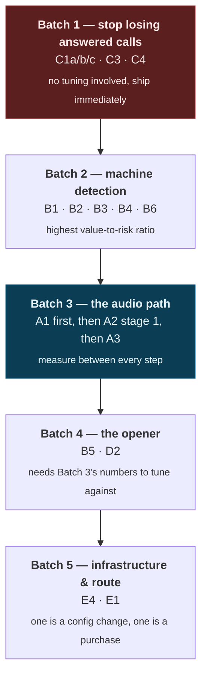

# Campaign teardown

A real instrumented run, read back defect by defect from its own log.

> **Run:** 50 dials · realtime brain + streaming TTS · foreign caller ID into
> domestic mobiles
> **Evidence:** 50 call records (JSONL), 1,906 log lines, the results file, the
> deployed configuration, and the source tree at that commit
> **Result:** 38 connected · 31 real conversations · 21.2 minutes of talk time ·
> **2 consented deliveries (4%)**
>
> Business names and numbers are removed; call indices, timings and counts are
> as recorded. Every number below is **counted from the run log**, not estimated.

This document exists because the interesting artifact is not the 4%. It is that
the run produced enough evidence to explain itself — and that when it was read
carefully, **the conversational layer turned out not to be the weak link.**

---

## The short version

Ranked by cost to the campaign, not by how hard they are to fix.

| # | Defect | Evidence | Severity | Effort |
|---|---|---|---|---|
| C1 | Brain WebSocket dies during long rings; the agent hangs up on people who answer | call #49, keepalive timeout at 82.6s | **Critical** | S |
| A2 | Turn fragmentation — 74% of prospect turns are ≤2 words, 58% are one word | 100 turns, median 1 word | **Critical** | M |
| B1–B4 | Every answering machine got pitched; the language-specific backstop is dead code | 8/8 detector verdicts overruled | **Critical** | S |
| A1 | Input noise reduction is not configured on the realtime session | absent from the session builder | **High** | XS |
| A3 | The echo gate discards 20–37% of the prospect's real speech | 909 frames = 18.2s dropped | **High** | S |
| D2 | The opener talks over the prospect on 21 of 38 connected calls | median 320ms, worst 3.48s | **High** | S |
| C5 | A refused consent call has no retry path — one conversion lost outright | #50, 119.6s conversation, nothing sent | **High** | S |
| B5 | The opener fires at 1.5s; the detector does not rule until 4.3–6.0s | 11 timeout releases | **High** | M |
| E1 | Foreign caller ID into domestic mobiles — 24% never connect, 18% answer into silence | 9 timeouts, 3 SIP 503/480, 7 dead-air answers | **High** | L (commercial) |
| C2 | The speaking flag is never cleared when a turn's audio ends → false underrun alarms | 4 of 5 warnings are ~11s idle gaps | Medium | XS |
| B6 | Premium machine detection is running on stock parameters | no detection config on the dial | Medium | S |
| C3 | Every unanswered call logs an `ERROR` | 12 × "read start event" = the 12 dead dials | Low | XS |
| C4 | SIP cause is never surfaced — 3 calls read as "unrecognised" | SIP 503 ×2, SIP 480 ×1 | Low | XS |
| E4 | Webhooks and media run over an ephemeral tunnel | quick-tunnel hostname in the deployed config | Medium | S |

---

## Part A — The audio path

> *The operator's observation going in was "most of what's coming into the call
> is people-noise."* That observation is correct and it is measurable. It is four
> separate mechanisms, and **they compound**: nothing filters the line before the
> VAD sees it, so the VAD commits a turn on every noise burst and every syllable,
> while our own echo gate throws away the quiet real speech in between.

### A1 — Noise reduction was never configured

The session's audio-input block carried exactly three keys: format, turn
detection, transcription. No noise reduction.

The vendor's own framing is the point:

> The Realtime API supports noise reduction for input audio, which filters audio
> **before it reaches the VAD and the model**. This process can improve the
> accuracy of turn detection by reducing false positives.

"Reducing false positives in turn detection" *is* the fragmentation problem in A2.
This is the cheapest fix in the entire document and it sits **upstream of the
expensive one** — which is the whole reason for ordering the work by mechanism
rather than by severity.

### A2 — The VAD was committing a turn per syllable

**The single largest quality defect in the run.** 100 prospect turns transcribed
across 34 calls:

- **median length: 1 word**, mean 2.1
- **58 of 100 turns are a single word**
- **74 of 100 turns are ≤2 words**

Per call, on the calls that had a real conversation:

| call | prospect turns | ≤2 words | talk time | total prospect speech |
|---|---|---|---|---|
| #48 | 15 | 13 | 72.7s | 20.7s |
| #39 | 10 | 8 | 34.3s | **3.6s** |
| #5 | 9 | 4 | 61.9s | 13.4s |
| #36 | 8 | 4 | 98.8s | 9.7s |
| #12 | 7 | 7 | 48.7s | 8.5s |
| #50 | 7 | 6 | 119.6s | 5.5s |
| #31 | 4 | 4 | 18.0s | 6.7s |

#39 is the clearest case: **3.6 seconds of speech split into 10 committed turns** —
360ms per turn. That is not a person taking ten turns. That is one or two sentences
chopped at every inter-word pause, plus noise bursts committing turns of their own.

**What each fragment costs.** The session runs with interrupt-on-turn and
respond-on-turn both enabled, so every committed fragment cancels whatever the agent
was saying *and* requests a new response to a one-word input. The downstream damage
is right there in the log:

- **17 ×** `turn stalled after interruption — prompting the model to continue`
- **18** resume prompts fired
- **79** back-channels withheld by our own gate — *that is the gate working*, and is
  a separate line item
- transcript lines that are pure noise-burst-as-turn

**Root cause, and the trade behind it.** The deployed config overrode the code's
default of semantic turn detection with a fixed-timer VAD at near-stock settings.
The code's own comment explains why semantic was chosen in the first place: *on a
cold call people trail off mid-sentence and a fixed timer answers half a question.*
Somebody then switched to the fixed timer **to get a loudness threshold**, because
room noise was taking the floor.

That is the real trade — and **A1 dissolves it.** With noise reduction filtering
before the VAD, semantic turn detection no longer needs a loudness knob it does not
have.

The fix is staged deliberately: widen the silence window and drop the threshold
first (with noise reduction now doing the noise job), then move back to semantic
detection on the *next* run, because the two changes are not separable if shipped
together. A note on the third stage: the server-side idle timeout that would let us
delete half of our own silence supervisor **only exists in fixed-timer mode**, so
choosing semantic detection gives it up. Do not do stages 2 and 3 together.

**Validation without a phone call.** The bench harness sweeps the exact knob against
a live session at realtime pace, and the targets are written down before the run:

| metric | baseline | target |
|---|---|---|
| median prospect turn length | 1 word | ≥4 words |
| turns ≤2 words | 74% | <35% |
| turn-stalled events | 17 over 35 calls | <5 |
| resume prompts | 18 | <6 |

**Risk, stated up front.** Widening the silence window adds latency to *every* reply.
That is the correct trade here — median reply latency is 1.33s and the fragments are
costing whole turns — but it has to be measured, not assumed, which is what the
sweep is for.

### A3 — Our own echo gate discarded a fifth to a third of real speech

Across the run the echo/back-channel gate discarded **909 frames above the speech
floor — 18.2 seconds of the prospect actually talking**, which the model never
heard.

This is the flip side of the barge-in design, and it is the reason the withheld-frame
accounting line exists at all: a call where the model "didn't respond" and a call
where the prospect "said nothing" and a call where **we ate the audio** are three
different bugs that look identical from the results file.

---

## Part B — Machine detection

### B1 — A single flag overruled every machine verdict

The dial was issued with machine-hangup disabled, so **8 of 8 detector verdicts were
overruled** and every answering machine in the run got the full pitch.

The detector itself was right. This is a configuration defect wearing a detection
defect's clothes, and it is the most expensive category of bug in this system:
*the thing that works is disabled by the thing that was supposed to make it safer.*

### B2 — The language-specific backstop was dead code

A carefully-built cue list for the campaign's actual language was declared and
**never referenced anywhere**. The backstop that was supposed to catch what the
detector missed could not fire at all.

### B3 — The other cue list could never match, by construction

The English list was matched against transcripts produced by an ASR pinned to a
different language. It was structurally incapable of matching, and no test covered
it because the test fixtures were written in the language the matcher expected
rather than the language the ASR emits.

### B5 — The opener fires at 1.5s; the detector does not rule until 4.3–6.0s

Eleven openers were released by the hard timeout rather than by evidence. That
timeout is set where it is because 2.8s of dead air is what a real prospect hung up
on — so this cannot be fixed by simply waiting longer.

The fix is a **cheap presence token at 1.5s** — something short enough that
colliding with it costs nothing — with the substantive line held until the far end
has handed the turn back. That splits the two jobs the opener was doing at once:
holding the line, and saying the thing.

### B7 — The one detector that worked

Worth recording alongside the failures: **premium carrier machine-detection got
every verdict right.** Every defect in Part B is about what was done with its answer,
not about the answer.

---

## Part C — Session and plumbing

### C1 — The brain socket died during a long ring, and took an answered call with it

**This cost a live, answered lead, and it will cost roughly one in every 40.**

Call #49:

```
02:56:47.369  dialing                             i=49
02:56:48.010  media websocket connected           (opens at dial)
02:56:49.145  session ready                       <- brain pre-connected
        ...   82 seconds of ringing, nothing reading the brain socket ...
02:58:10.890  stream started                      <- carrier `start`, on answer
02:58:10.890  brain ws closed  error="close 1011 (internal server error):
                                       keepalive ping timeout"
02:58:11.087  call answered                       <- A REAL PERSON PICKED UP
02:58:11.6..  session closed  disposition=incomplete  hangup_by=agent
02:58:11.6..  ERROR no session for call  (×4, as the carrier retried the media socket)
02:58:14.7..  machine detection  result=human_residence   <- the carrier agrees: a human
02:58:19.5..  call hangup  source=callee
```

A human answered after 82.9s of ringing, the carrier classified them as a person,
and they got a dead line. Talk time: 0.2 seconds.

**Root cause is a three-part interaction, and each part is individually correct:**

1. The brain WebSocket is pre-connected **at dial time** — deliberately, to move the
   handshake out of the post-pickup silence. (This is a *good* optimisation; see
   [engineering-log.md](engineering-log.md#latency).)
2. Nothing reads that socket until the audio bridge starts, and the bridge only
   starts when the carrier's `start` event arrives — which, despite
   stream-before-dial being enabled, lands **on answer**, not at dial.
3. The WebSocket library replies to a server PING **only from inside a read call**.
   With no reader, the server's keepalive pings go unanswered and it closes the
   session.

The voice socket does not have this bug, because its constructor starts a read pump
before returning. The brain's did not.

**Why it destroyed the call rather than just the socket:** the read loop cancels the
session on socket close, which ran the finaliser and removed the session from the
registry — **200ms before the answer event arrived.** The four "no session" errors
are the carrier re-establishing a media socket against a session that no longer
exists.

**Three changes, all needed:**

- **Start the read pump at connect, not at pickup.** Drain the socket — and answer
  pongs — from the moment it exists.
- **Application-level keepalive**, independently: ping every 20s with a read deadline
  and pong handler. It also detects a half-open socket during a long mid-call
  silence.
- **Never let a brain-socket failure kill a call that has been answered.** Before
  pickup a dead socket is recoverable — reconnect. After pickup it is not, but the
  call must still be ended *deliberately* — goodbye, disposition, hangup — rather
  than by cancelling the session out from under a live human.

**Reproducible without a phone call:** connect a session, sleep 120s without reading,
assert the socket is still open. The connection host and scheme are already
injectable variables for exactly this kind of test.

**Blast radius in this run.** One call died outright. Four more answered between
57.6s and 69.2s and survived only because they landed inside the keepalive window.
**13% of connected calls (5 of 38) rang long enough to be at risk.**

### C5 — A correctly-refused send had no retry path, and it cost the run's best call

Call #50, the strongest conversation of the campaign:

```
 69.2s  AGENT     [full pitch] …shall I send you the demo link?
 86.6s  AGENT     Alright sir, one second—
 86.9s  tool      send_demo_link
 86.9s  WARN      send_demo_link REFUSED — asked, but they have not answered yet
 88.2s  PROSPECT  [affirmative]                   <- they answer 1.3s later
 88.2s  DEBUG     prospect has answered the link offer
 88.2s  AGENT     I'm starting the process of sending it on WhatsApp now.  <- it was not
111.1s  PROSPECT  "look, I just checked"
112.4s  AGENT     Sir, are you still on the line?
131.9s  call hangup  source=callee
```

The full pitch landed. The offer was made properly. **The prospect answered 1.3
seconds after the model jumped the gun, and nothing was ever sent.** He went to check
his phone, found nothing, and left. 119.6 seconds of talk time — the longest
conversation in the run — dispositioned `incomplete`.

**The guard is correct.** It is protecting a marketing message to a stranger's phone,
and the model *did* call the tool before the prospect answered. The bug is that the
refusal is a **dead end**: the consent latch closes 1.3s later and nothing re-arms
the send.

The fix is a one-shot retry armed when the latch closes: *a send refused for being
early is not a send that should never happen.*

**And a second, separate bug in the same transcript.** The agent said it was sending
when no send had happened. The playbook already banned announcing tool calls; it now
also bans **claiming an outcome a tool has not returned** — never say the link is
sent until the tool says `sent: true`.

### C2, C3, C4 — Observability defects that cost analysis time

- The agent-speaking flag was never cleared when a turn's audio ended, so 4 of 5
  playout-underrun warnings were ~11-second *idle* gaps — an alarm that fires on
  normal operation is an alarm nobody reads.
- Every unanswered call logged an `ERROR`. Twelve of them, which were exactly the 12
  dead dials. A no-answer is a normal outcome of cold calling; logging it at ERROR
  buries the real errors.
- SIP cause was never surfaced, so three distinct failures (2 × 503, 1 × 480) read as
  a single "unrecognised" bucket.

---

## Part D — Conversation quality

### D2 — The opener talked over the prospect on 21 of 38 connected calls

`spoke_during_opener_ms > 0` on 21 calls. Median 320ms, worst **3,480ms** — which was
a voicemail, so the agent talked over a recording for 3.5 seconds while the recording
talked over it. Full distribution:

```
3480 2220 2140 1960 1580 880 620 480 440 340 320 280  ms
```

Same knob as B5, same fix. Plus a ceiling the original design deliberately did not
have: the opener plays to completion regardless, which is **right for a 200ms "yes"
and wrong for a 2.1-second overlap**. Above ~1.2s of continuous prospect speech, stop
the opener, clear the buffer, and let the model respond to what they actually said —
reusing the barge-in gate's run-length logic with a longer minimum rather than adding
a second mechanism.

That instrumentation existed only because a previous change had explicitly written
down what it was trading away: the personal opener costs +1.6s over the plain one, so
every call records how long the prospect spoke *during* it. The cost of the trade was
measured because someone predicted it would need measuring.

### D3 — The prompt is doing its job; the transcript is not

Read the agent's side of the two longest calls: the language is natural, the pitch is
on script, the objection handling is real.

**The conversational layer is not the weak link — the audio layer is.** Nothing in
Part D should be prioritised above Parts A, B and C1. This is the finding that most
changed what got worked on next, and it is only available because the run recorded
both channels.

---

## Part E — Route and infrastructure

### E1 — Foreign caller ID into domestic mobiles

The commercial defect, and the expensive one:

- 9 dials timed out without connecting
- 3 were rejected by the carrier (SIP 503 ×2, SIP 480)
- 7 answered into dead air

**24% never connected. 18% of answers heard silence.** Nothing in this program can
influence whether a distant carrier completes a call from a foreign number — and
the pattern being blocked is *exactly* the pattern the system generates.

The fix is commercial rather than technical: a domestic number on a domestic
connection. It is listed here as a defect with an effort estimate anyway, because a
technical fix list that silently omits the largest cause is not an analysis.

### E4 — Webhooks and media over an ephemeral tunnel

The deployed configuration pointed at a quick-tunnel hostname — no stable DNS, no
certificate you control, and a hostname that changes on restart. Fine for a
development loop; not fine for a run whose failure mode is "the carrier could not
reach us and the calls just did not connect."

---

## Part F — What this analysis could not answer

Recorded deliberately, because the gaps in an instrumentation set are only visible
when you try to use it:

| Question | Why it could not be answered | Now recorded |
|---|---|---|
| How much of the opener overlap was voicemail vs person? | Overlap and detector verdict were in different records | joined on the call record |
| Which fragment turns produced a resume prompt? | Resume prompts logged without a turn id | turn id on the event |
| Was the echo gate's discard concentrated in a few calls? | Only a run-level total existed | per-call counter |
| Did widening the silence window change reply latency? | No baseline captured per config | manifest pins the config per run |

---

## Order of work

Sequenced by **mechanism**, not by severity — because several of these are upstream
of each other and fixing them out of order means measuring noise.



**A1 ships before A2** because it is upstream: noise reduction changes what the VAD
sees, so tuning the VAD first means tuning it against input that is about to change.

**C5's retry is in Batch 1, not Batch 4**, despite being a conversation-layer fix.
It is a five-line change that recovers a conversion the system already earned.

---

## What "fixed" looks like

Written down *before* the next run, so the next teardown has something to be measured
against — which is the entire lesson of the answer-supervision defect in
[engineering-log.md](engineering-log.md#answer-supervision): a distribution with no
recorded baseline can be badly clipped and still look healthy.

| Metric | This run | Target |
|---|---|---|
| Connected calls lost to a dead brain socket | 1 (+4 at risk) | 0 |
| Answering machines pitched | 8 of 8 | 0 |
| Prospect turns ≤2 words | 74% | <35% |
| Median prospect turn length | 1 word | ≥4 words |
| Real speech discarded by the echo gate | 18.2s | <5s |
| Opener overlap on connected calls | 21 of 38 | <8 of 38 |
| Consented sends that never dispatched | 1 | 0 |
| Dials that never connected | 24% | route-dependent; measure separately |

---

## The method, stated plainly

Because it is the transferable part:

1. **Count everything from the run's own log.** No claim in this document is an
   impression. Where a number is an estimate, it says so.
2. **Cite by file and line** against the tree at that commit, so a fix can be found
   and a claim can be checked.
3. **Re-read the API contract from the vendor's documentation** rather than recalling
   it. Two of the defects above are the difference between what the API does and what
   everyone remembered it doing.
4. **Rank by cost to the outcome, then re-sequence by mechanism.** Those are two
   different orderings and both are needed.
5. **Write down the target before the next run.** A metric with no recorded baseline
   cannot be regressed, which means it cannot be trusted either.
6. **Record what the analysis could not answer.** That list is the next
   instrumentation backlog.
