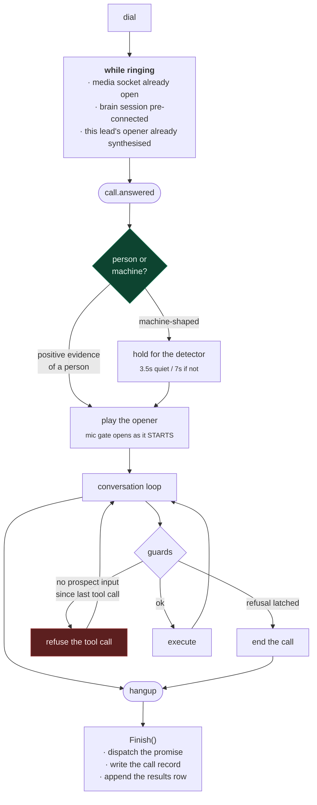

# voice

The conversation. A single Go binary that dials a ranked lead list, holds a real
outbound call, gets permission to send a demo link, and hands the promise to the
[messaging sidecar](../messaging) the instant the line drops.

The call is 40–120 seconds. Saying yes is the whole win — there is no meeting to
book and nothing to buy on the call.

```
lead list ──▶ voice agent ──▶ carrier ──▶ ☎ call ──▶ "yes, send it"
                                                          │
                                POST /queue (loopback)    ▼
                                            messaging sidecar ──▶ 💬
```

> The shipped playbook is written for a Hindi-first campaign with mid-call
> switching to English. Language, brand, pitch stages and objection handling are
> all in one file; the call machinery below is language-agnostic.

---

## Build and run

```bash
cp .env.example .env      # carrier, model and voice credentials
go build -o voice-agent .
go test ./...

go run . -dry-run         # parse the lead file, print who would be dialled
go run .                  # ⚠ this begins calling
```

**Start the messaging sidecar first.** The agent **refuses to dial** if it is not
linked, because every "yes, send it" on the call is otherwise a promise that
silently never lands. This used to be a warning, and a warning is something you walk
past — seven live calls went out against a dead sidecar, each one telling a real
person their link was on the way. `-allow-undelivered` overrides it for pipeline
testing; it has to be typed, and it says exactly what it costs.

---

## Testing without phoning a stranger

Four harnesses, in increasing order of realism. None of them dials.

```bash
# The real audio session, the real prompt, the real tools — prints every tool call
# and, via output transcription, what the agent ACTUALLY said.
go run . -probe
go run . -probe -sim-prospect "#42"        # the 42nd lead in the campaign file
go run . -probe -sim-prospect "Meridian"   # first lead matching that name

# Pipe a whole conversation in:
printf 'Yes, speaking\nHow much does it cost?\nAlright, send it\nAlex\n' | go run . -probe
```

```bash
go run . -say "your opening line here"     # how long does it take to SPEAK?
go run . -opener-preview 10                # ...across real lead rows, + .wav files
go run . -opener-preview 10 -opener-preview-dir /tmp/op
```

```bash
go run . -bench                            # replay a REAL prospect turn through a
                                           # live session at realtime pace, and report
                                           # the silence the caller actually sits through
go run . -bench -bench-silence 500,900     # sweep the turn-detection window
go run . -tts-bench                        # compare synthesis latency
```

```bash
go run . -local                            # talk to it through your own mic/speakers
                                           # (needs ffmpeg + ffplay)
go run . -report campaignlogs/run.jsonl    # read a finished run back as a funnel
```

`-sim-prospect` pulls a **real row from the campaign file**, so the harness exercises
the same per-lead pitch logic as a live dial. A hand-written stub would silently
rehearse a different script than the one that gets dialled.

---

## How a call runs



Everything in the "while ringing" box exists to make time-to-first-audio ≈ 0 instead
of 1.5–3.5s. See [engineering-log.md § Latency](../../docs/engineering-log.md#latency).

---

## The pitch

Six stages, **one per conversational turn**. The single biggest failure mode is the
model reciting all six as one monologue, which on a real call is a hangup — the
prompt fights this with a worked wrong/right example and a hard two-sentence cap.

| Stage | What it does |
|---|---|
| 1 | **Lead with something true about them** — their real review count, off their own listing. It gives before it asks, and it is not a sentence a spam dialler can produce. |
| 2 | **Praise, with real numbers** — rating, review count, follower count. Proves you looked. |
| 3 | **The gap** — the one specific true thing about their web presence. |
| 4 | **The cost** — one line on what the gap costs them. |
| 5 | **The gift + the ask** — "I've already built you a demo, free. Shall I send the link?" *Past tense: it already exists.* |
| 6 | **Their name** — only once they're warm. |
| 7 | **A time to talk again.** Never hang up without it: a sent link nobody follows up on is a wasted lead. |

### The gap line is per-lead and must never be a lie

46% of one list had *something* at a website URL, so a blanket "you don't have a
website" would be provably false on hundreds of calls. The line is derived from the
scraper's own classification, and the **unknown bucket asks instead of asserting**:

| Situation | Leads | What the agent says |
|---|---|---|
| No website at all | 749 | "you don't have a website" |
| The "website" is a social profile | 595 | "that's actually a social page" |
| **Unknown** | 347 | **asks** — "do you have a website of your own?" |
| Site is down | 123 | "your website isn't loading at all" |
| Link-hub / old builder / HTTP-only / decent site | 161 | one specific line each |

The classification always outranks the raw website cell — a blank cell must not
override an explicit classification, and that ordering bug is covered by a test.

### The first line is measured, not estimated

The opener plays to completion — barge-in is deliberately off for it — so every
syllable is one the prospect cannot talk through. `-say` times a candidate through
the real synthesiser before a stranger ever hears it:

| Line | Spoken |
|---|---|
| "Hello sir, am I speaking to X?" (the old one) | 3.5s |
| "Hello sir! I saw your 474 reviews — this is X, right?" | **5.1s** ← shipped |
| "…saw them — very impressive! This is X, right?" | 6.3s |

The explicit compliment is cut because **the number *is* the compliment**, and 1.2s
is the difference between an opening and a monologue. The first draft read as tight
on the page and measured **7.4 seconds**.

The praise is refused entirely when the row cannot back one up — below a review or
follower floor, the agent falls back to the plain confirm line rather than praising
someone for eleven reviews.

### Language switching

The agent switches to English **mid-call and permanently** the moment the prospect
replies in English, says they don't speak the campaign language, or answers in one it
doesn't recognise. It reports the switch, and the follow-up message is written in
whichever language the call ended in.

---

## Guards

Enforced in code, not in the prompt. Each one exists because the prompt already said
the right thing and the model did the other thing — see
[ADR 0003](../../docs/adr/0003-guardrails-in-code.md).

| Guard | Where |
|---|---|
| A refusal ends the call | `suppression.go` — a transcript scanner latches independently of the model; `tools.go` and `outreach.go` each refuse again |
| No fabricated prospect input | `session.go` — a tool call is refused when the prospect has made no sound and produced no transcript since the model's last tool call |
| No repeating a fact the opener already spent | `pitch_hi.go` — the research builder omits the figure entirely |
| Barge-in on duration, not loudness | `barge.go` — a run of ≥360ms, with parked frames released in order |
| The agent is actually talking | `health.go` — the campaign stops below a 50% reply rate over calls that gave it a chance to speak |

---

## Tools the model can call

| Tool | When |
|---|---|
| `capture_lead(name)` | The instant they say **their own** first name. A cleaner rejects the business name, honorifics and junk — the model demonstrably hands back the business name as the owner, and a wrong name goes straight into the follow-up greeting. |
| `send_demo_link(channel, email)` | The instant they agree. Recorded on the session and dispatched **after hangup** — doing the network call inline would freeze the agent mid-sentence at the most important moment of the call. |
| `set_followup(when, kind)` | Stage 7. `kind`: `meeting` (they named a time), `callback` (vague), `declined`. An unrecognised kind is kept as `callback` rather than dropped — it is still the only next step the call produced. |
| `end_call(disposition, callback)` | Always. `link_sent`, `interested`, `callback`, `not_interested`, `do_not_call`, `gatekeeper`, `wrong_number`, `voicemail`. |

**Tool responses are prompt.** Each names exactly one thing to say and requires
silence after it. A list of steps is a list the model will complete — that is how the
agent came to hold a four-turn conversation with itself in 4.1 seconds.

---

## Running a campaign

```bash
./run_campaign.sh leads.csv 35 run3        # bounded, fully recorded
./watch_campaign.sh run3                   # from a second terminal
./voice-agent -report campaignlogs/run3.jsonl
```

`run_campaign.sh` refuses to dial outside working hours or on weekends unless
`--force` is passed. It also refuses to reuse a run tag, and refuses to start if the
messaging sidecar is not linked.

**The hour is a variable of the experiment, not a detail of it.** The first campaign
went out in the evening; three of six connections were answering machines and nobody
was in a mood to hear about websites. None of that was the pitch's fault, which is
exactly the problem — a badly-timed run produces numbers that cannot be read.

### `campaignlogs/<tag>.jsonl`

One JSON object per call, plus a **manifest on line one pinning every tunable that
run used**. Append-only and fsynced per record, so a campaign killed mid-run loses
nothing.

Each record carries: when it was answered, **which rule released the opener and how
long after pickup**, **what the detector said and how late**, how much of the
prospect's audio reached the model, every reply latency, the whole transcript, and
what was *promised* versus what was *delivered*.

`-report` folds it into a funnel, an opener-reason histogram, the detector's latency
distribution, reply-latency percentiles, the barge-in gate's own behaviour, an
answer-supervision section, and the sidecar deltas. It runs automatically at the end
of every campaign.

The report is **tested against a real campaign's numbers**: given those nine calls it
independently reproduces the hand-written teardown's findings.

---

## Input and output

### Input — the lead file

Columns are mapped **by header name**, case-, space- and underscore-insensitive.

Used on the call: `Business Name`, `Phone`, `Demo Site`, `Pitch Angle`, `Rating`,
`Reviews`, `IG Followers`, `City`, `Area`, `Vertical`, `Category`, `Website`.
Carried but never spoken: `Email`, `Price`, `Segment`, `City Tier`, `Line Type`.

`DEFAULT_REGION` decides how a bare national-format number is read. It **cannot** be
inferred from the digits — mobile ranges overlap across countries — so it is
explicit. Numbers already in E.164 are unaffected.

The scraper writes integers as floats (`474.0`); they are trimmed before anything
speaks them, so the agent doesn't say "four hundred seventy four point zero".

A synthetic sample lives in [`data/sample_leads.csv`](data/sample_leads.csv).

### Output — `results.csv`

```
timestamp, phone, business, owner_name, city, rating, reviews, disposition,
callback, hangup_by, link_channel, link_status, demo_url, email, language,
followup_kind, followup_when, call_id, connected_sec, prospect_speech_ms, agent_turns
```

- `followup_kind` / `followup_when` are the campaign's call-back list.
- **`answer_lost`** is the disposition to watch: the prospect picked up a call the
  network never told us was answered, sat in silence, and hung up. It is a **route**
  fault wearing a lead outcome's clothes, and it used to be filed as `no_answer`.
- `connected_sec`, `prospect_speech_ms` and `agent_turns` say whether a call
  *functioned*, as opposed to what it was for. They turn "did the agent talk on this
  one?" from an afternoon with six recordings into a column.
- `link_status` is what **actually** happened to the promise — `queued`, `duplicate`,
  `failed`, `suppressed` — not what the agent said. `duplicate` matters: the sidecar
  answers `202` either way, so a dialer that only checked the status code once
  reported seven deliveries backed by one job.

---

## File layout

| File | Responsibility |
|---|---|
| `main.go` | Config, campaign loop, opener prefetch, brain pre-connect |
| `session.go` | `Session`, media-stream handler, audio bridges, listen-first opener, tool handling, silence supervisor |
| `brain.go` | Realtime model client — session config, turn detection, transcription |
| `voice.go` | Streaming TTS client → μ-law, no transcode in the hot path |
| `telnyx.go` | Dial, hangup, streaming start, webhooks, machine detection |
| `opener.go` / `openerpreview.go` | Opener synthesis, prefetch pool, `-say` / `-opener-preview` |
| `pitch_hi.go` | The playbook, per-lead research, gap derivation, opener lines, name cleaning |
| `tools.go` | Tool declarations and responses |
| `barge.go` | Duration-based barge-in decision |
| `thinking.go` | Acknowledgement fillers played while the model composes |
| `suppression.go` | Refusal cues, do-not-call list |
| `health.go` | Stops the run if the agent is connecting but not conversing |
| `outreach.go` | Sidecar dispatch, email queue, the last refusal gate |
| `leads.go` | CSV in/out, `Prospect`, `Result`, phone normalisation |
| `audio.go` | μ-law codec and resampling |
| `runlog.go` | The per-run JSONL: manifest, one record per call, sidecar samples |
| `report.go` | `-report` — reads a run back as a funnel and a set of distributions |
| `bench.go` / `probe.go` / `local.go` / `harness.go` | Offline harnesses |

## Conventions

- All files are `package main`, single binary; structured logging throughout
- Both WebSocket write paths are mutex-protected
- The brain connection is installed exactly once under a mutex — the dial-time
  pre-connect and the media-stream handler race for it, and the loser closes its own
- `Session.Finish()` is `sync.Once`-protected and is where dispatch happens
- Calls are **strictly sequential**: the next dial waits for the previous to finish
- Both prospect-side and agent-side audio are transcribed; the prospect side feeds
  the refusal scanner and the machine-cue backstop
